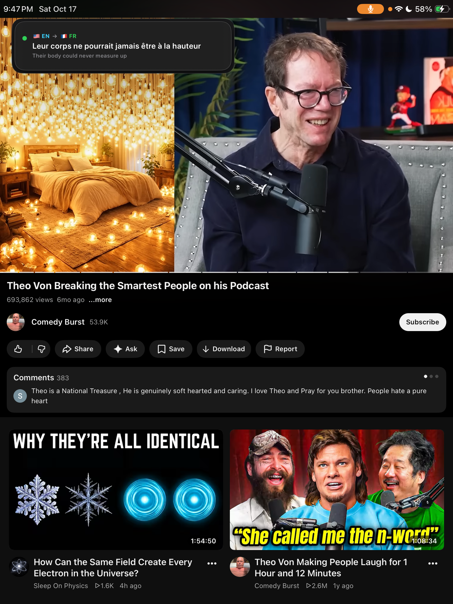
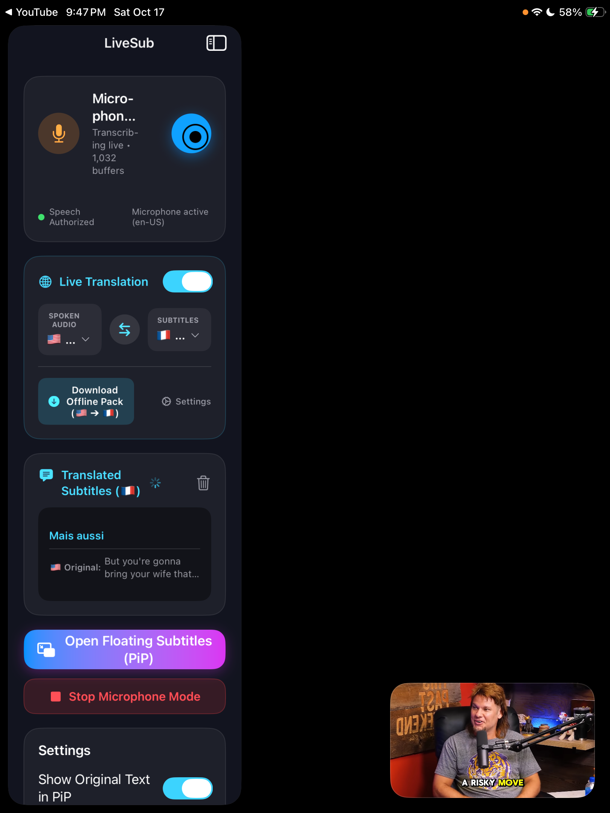
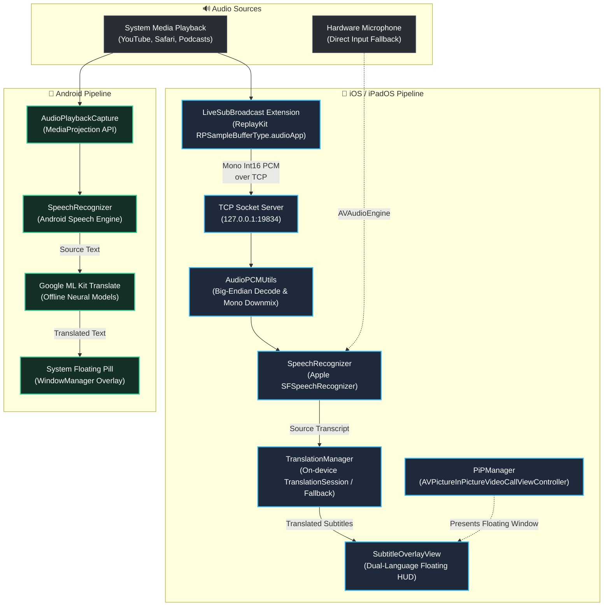

# LiveSub — On-Device Real-Time Subtitles & Translation (iOS & Android)

> **LiveSub** captures playback audio internally (or via microphone fallback) and displays continuous, real-time translated subtitles in a cinematic, floating overlay on top of any video, game, or stream.

<div align="center">

[](https://github.com/martinfou/live-sub/actions/workflows/build-apk.yml)
[](https://github.com/martinfou/live-sub/releases/latest)
[](https://opensource.org/licenses/MIT)

### 📥 [Download Ready-to-Install APK (GitHub Releases)](https://github.com/martinfou/live-sub/releases/latest)

</div>

---

## 📸 Screenshots

### 🍎 iOS & iPadOS (Picture-in-Picture Floating Subtitles)

<div align="center">

| 🎬 Real-Time Translation Over YouTube (PiP HUD) | ⚙️ LiveSub iOS & iPadOS Dashboard |
| :---: | :---: |
|  |  |
| *Floating Picture-in-Picture HUD translating English YouTube podcast audio into French in real-time with dual-line display* | *Language selector (`🇺🇸 ⇄ 🇫🇷`), on-device offline download controls, and live audio packet diagnostics* |

</div>

### 🤖 Android (System Floating Pill Overlay)

<div align="center">

| 🎬 Real-time Translation Overlay (YouTube / Streaming) | ⚙️ Language Pair & Service Dashboard |
| :---: | :---: |
|  |  |
| *Floating pill translating German to French over YouTube playback with zero audio stutter* | *On-device setup, offline translation model status, and live audio indicator* |

</div>

---

## ✨ Key Features

- **🎧 Internal Audio Capture via ReplayKit Broadcast (iOS) & AudioPlaybackCapture (Android):** Captures high-fidelity internal digital PCM streams without ambient noise or requiring loud speaker output.
- **⚡ Continuous On-Device Speech Recognition:** Streams speech segments directly into Apple SFSpeechRecognizer and Android Speech Recognition with automatic sentence finalization.
- **🌐 100% On-Device Neural Translation:**
  - **iOS:** Powered by Apple's native `Translation.framework` (iOS 17.4+ / iOS 18+) with offline model pack downloads and ultra-fast network fallback.
  - **Android:** Powered by Google ML Kit Translate with offline neural models.
- **💊 Floating Overlay Subtitles:**
  - **iOS:** Native Picture-in-Picture (`AVPictureInPictureVideoCallViewController`) floating HUD that stays active over YouTube, Netflix, Podcasts, or any application.
  - **Android:** Hardware-accelerated system window overlay (`WindowManager`) draggable anywhere across display boundaries.
- **🔄 Dual-Language Display:** Prominently highlights translated text in bold, with optional original spoken speech displayed underneath.
- **🎤 Microphone Fallback:** Test via hardware microphone with one tap or fallback if internal media capture is restricted.
- **📝 SubRip (.SRT) Export:** Automatically tracks and exports session subtitle history into timestamped `.srt` files.

---

## 🛠️ Build & Run

### 🍎 iOS / iPadOS Project

#### Prerequisites
- macOS Sonoma / Sequoia
- Xcode 16+
- [XcodeGen](https://github.com/yonaskolb/XcodeGen) (`brew install xcodegen`)

```bash
cd ios

# Generate Xcode project
xcodegen generate

# Build for Simulator
xcodebuild -project LiveSub.xcodeproj -scheme LiveSub -destination 'platform=iOS Simulator,name=iPhone 16 Pro' build

# Or deploy to connected iPad / iPhone
xcodebuild -project LiveSub.xcodeproj -scheme LiveSub -destination 'id=<DEVICE_UDID>' -allowProvisioningUpdates build
```

---

### 🤖 Android Project

#### Prerequisites
- Android Studio Ladybug / Meerkat or Command-Line Tools
- Android SDK 35 (minSdk 29, targetSdk 35)
- JDK 17

```bash
# Run unit tests
./gradlew testDebugUnitTest

# Assemble debug APK
./gradlew assembleDebug
```

The compiled APK will be located at:
```
app/build/outputs/apk/debug/app-debug.apk
```

---

## 🏗️ Architecture & Data Flow



---

## 📜 License

This project is licensed under the MIT License.
