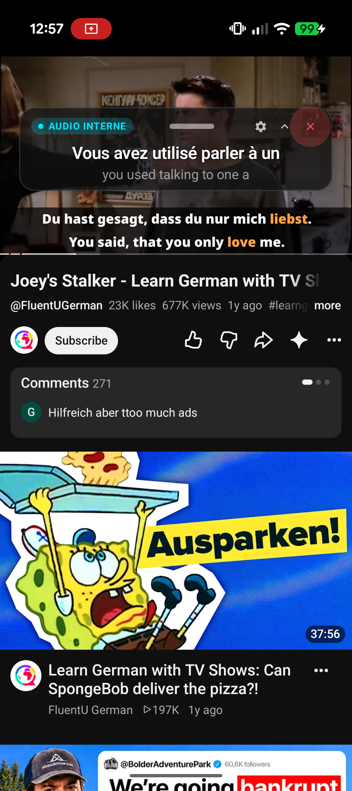
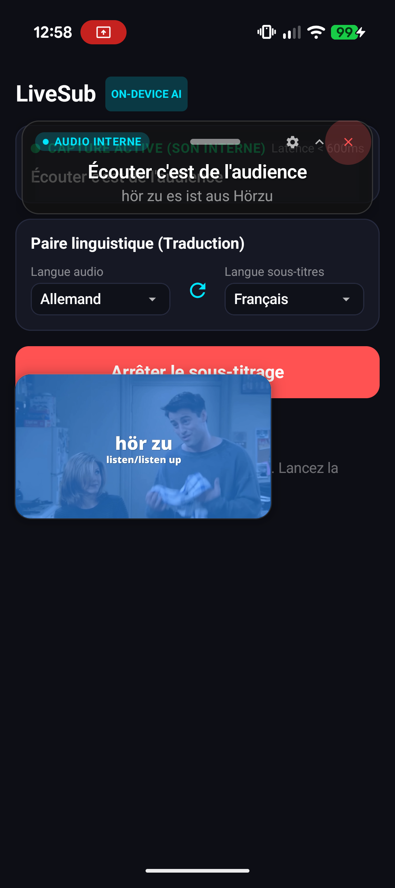

# LiveSub — On-Device Real-Time Subtitles & Translation for Android

> **LiveSub** captures playback audio internally (or via microphone fallback) and displays continuous, real-time translated subtitles in a cinematic, floating overlay on top of any video, game, or stream.

<div align="center">

[](https://github.com/martinfou/close-caption/actions/workflows/build-apk.yml)
[](https://github.com/martinfou/close-caption/releases/latest)
[](https://opensource.org/licenses/MIT)

### 📥 [Download Ready-to-Install APK (GitHub Releases)](https://github.com/martinfou/close-caption/releases/latest)

</div>

---

## 📸 Screenshots

<div align="center">

| 🎬 Real-time Translation Overlay (YouTube / Streaming) | ⚙️ Language Pair & Service Dashboard |
| :---: | :---: |
|  |  |
| *Floating pill translating German to French over YouTube playback with zero audio stutter* | *On-device setup, offline translation model status, and live audio indicator* |

</div>

---

## ✨ Key Features

- **🎧 Pure Internal Audio Capture:** Captures high-fidelity internal digital PCM streams (Android 10+ `AudioPlaybackCapture`) without ambient noise or requiring loud speaker output.
- **⚡ Continuous On-Device Speech Recognition:** Streams speech segments directly into Android's offline/online speech recognition engine with automatic sentence finalization.
- **🌐 100% On-Device Neural Translation:** Powered by Google ML Kit Translate. Models are stored locally on the device — no subscriptions, no cloud latency, completely private.
- **💊 Cinematic Floating Pill Overlay:**
  - **Draggable anywhere:** Smooth drag gesture without lag across full display boundaries.
  - **Bilingual display:** Prominently highlights translated text with original source preview.
  - **Hardware accelerated:** GPU-rendered through system `WindowManager` with zero jitter.
  - **Customizable:** Dynamic pinch-to-zoom font scaling, background opacity slider, and quick collapse/expand modes.
- **🔄 Smart Microphone Fallback:** Seamlessly switches to hardware microphone if internal media capture is restricted by DRM.
- **📝 SubRip (.SRT) Export:** Automatically tracks and exports session subtitle history into timestamped `.srt` files.

---

## 🚀 Quick Start (Installation)

1. Go to the **[Latest GitHub Release](https://github.com/martinfou/close-caption/releases/latest)**.
2. Download **`LiveSub-debug.apk`**.
3. Open the file on your Android device (Android 10+ recommended, Android 13+ for direct pipe playback capture).
4. Allow installation from unknown sources when prompted.
5. Open **LiveSub**, grant the overlay and audio permissions, select your language pair, and tap **Démarrer le sous-titrage** !

---

## 🛠️ Build From Source

### Prerequisites
- Android Studio Ladybug / Meerkat or Command-Line Tools
- Android SDK 35 (minSdk 29, targetSdk 35)
- JDK 17

```bash
# Clone the repository
git clone https://github.com/martinfou/close-caption.git
cd close-caption

# Run unit tests
./gradlew testDebugUnitTest

# Assemble debug APK
./gradlew assembleDebug
```

The compiled APK will be located at:
```
app/build/outputs/apk/debug/app-debug.apk
```

---

## 📄 Architecture Overview

```
[System Audio / MediaProjection]
               │
               ▼
     [AudioCaptureService] ── (16kHz PCM Stream) ──► [VadFilter]
                                                           │
                                                           ▼
                                                [StreamingAsrProcessor]
                                                           │
                                                           ▼
                                               [AndroidSpeechRecognizerEngine]
                                                           │ (AsrResult)
                                                           ▼
                                              [MlKitTranslationEngine]
                                                           │ (Bilingual SubtitleItem)
                                                           ▼
                                                  [SubtitlePill Overlay]
```

---

## 📜 License

This project is licensed under the MIT License.
